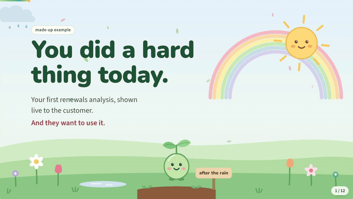
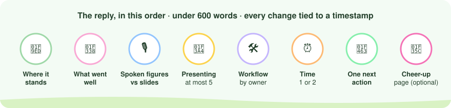

<h1 align="center">after-the-call 🌱</h1>
<p align="center"><em>The kind, specific debrief you need right after a presentation that felt like it went badly.</em></p>

<table>
<tr>
<td width="33%" align="center" valign="top"><a href="https://wan-huiyan.github.io/after-the-call/docs/demo/garden.html"></a><br/><sub><b>🌷 Garden</b>: flowers sprout as you go<br/><a href="https://wan-huiyan.github.io/after-the-call/docs/demo/garden.html">open live →</a></sub></td>
<td width="33%" align="center" valign="top"><a href="https://wan-huiyan.github.io/after-the-call/docs/demo/scrapbook.html"></a><br/><sub><b>📎 Scrapbook</b>: polaroids pin in place<br/><a href="https://wan-huiyan.github.io/after-the-call/docs/demo/scrapbook.html">open live →</a></sub></td>
<td width="33%" align="center" valign="top"><a href="https://wan-huiyan.github.io/after-the-call/docs/demo/cozy-quest.html"></a><br/><sub><b>🎮 Cozy quest</b>: each tip fills an XP bar<br/><a href="https://wan-huiyan.github.io/after-the-call/docs/demo/cozy-quest.html">open live →</a></sub></td>
</tr>
</table>

<p align="center"><sub>The decks show a made-up call (Morgan, Jo and Kit are invented). Yours is built from your own transcript.</sub></p>

<p align="center">
  <a href="LICENSE"></a>
  <a href="https://github.com/wan-huiyan/after-the-call/commits"></a>
  
  <a href="https://claude.com/claude-code"></a>
</p>

> **Hand Claude the call transcript, your slides and your "I think that went badly" message, and get back a debrief under 600 words: what the audience actually decided, what went well in their own words, and at most a handful of changes, each tied to the minute it would have helped.**

<p align="center">
  
</p>
<p align="center"><sub>Every reply follows the same eight parts, so a tired reader can skim it on a phone.</sub></p>

## Why it exists 💭

After a hard call you usually get one of two things: a pep talk, or a wall of generic tips ("know your audience"). Neither helps. This skill was written after a real client call that felt like it had flopped, while the transcript said otherwise.

It also fixes a hidden unfairness. Meeting notetakers mishear numbers ("seventeen" becomes "seventy"), and an AI reading the transcript will happily coach the speaker to "say the numbers as on the slide", for a slip they never made. So this skill checks the spoken figure against the slide first, and asks before it blames anyone.

## What it does ✨

| | Part | What you get |
|---|---|---|
| 🧭 | **Where it stands** | 3 to 5 bullets: what the audience decided, quoted with timestamps, and what a "pause" or "no" literally covers |
| 🌸 | **What went well** | 2 or 3 points in the audience's own words. Always there, even when it went badly |
| 🎙️ | **Spoken figures vs slides** | A figure that sounds like the slide's (17 vs "seventy") is called a transcription error, not a slip |
| 🎤 | **Presenting** | At most 5 changes, each tied to a moment ("they asked which one first at 9:30; the options came at 24:00") |
| 🛠️ | **Workflow** | At most 4 changes, split by who owns them, an AI deck-builder included |
| ⏰ | **Time** | 1 or 2 changes, for example keeping the last 2 to 3 hours for one run-through out loud, and lunch |
| 👣 | **One next action** | Something doable today, usually prep for the meeting already booked |
| 🍜 | **Cheer-up page** | Offered in one line: a cute HTML page or slide deck of the learnings, in [garden 🌷](https://wan-huiyan.github.io/after-the-call/docs/demo/garden.html), [scrapbook 📎](https://wan-huiyan.github.io/after-the-call/docs/demo/scrapbook.html) or [cozy quest 🎮](https://wan-huiyan.github.io/after-the-call/docs/demo/cozy-quest.html) style |

## Quick start 🚀

```bash
/plugin marketplace add wan-huiyan/after-the-call
/plugin install after-the-call@wan-huiyan-after-the-call
```

<details><summary>Shell form / git clone</summary>

```bash
claude plugin marketplace add wan-huiyan/after-the-call
git clone https://github.com/wan-huiyan/after-the-call /tmp/after-the-call
cp -r /tmp/after-the-call/plugins/after-the-call/skills/after-the-call ~/.claude/skills/
```
</details>

## Usage 💬

> **You:** the call just happened and I think it went badly. Here's the transcript, my slides and my Slack to my PM. How can I do better next time?

> **Claude** *(illustrative example, a made-up call)*:
> **Where it stands**: The "pause" at 00:33:00 is "a product launch this month, so new analysis waits until after it". That is about their own schedule, not a rejection.
> **Spoken figures vs the slides**: "Seventy" against the slide's 17 looks like a transcription error, so I would not coach you on it. Same for "fifty fifty-five" where the slide says 15. If the AI meeting summary repeats either figure, use the slide figures in the follow-up email.
> **Presenting**: 1. Start with the answer. At 00:09:30 Morgan asked "So which one first?", and the options came at 00:24:00.

Then ask for the cheer-up page ("can you make our learnings into something cute?") and it follows [`cheer-page-recipe.md`](plugins/after-the-call/skills/after-the-call/cheer-page-recipe.md): one content file, the three styles in the gallery at the top to pick from, then a check of every screen before you see it.

## Tested, not just written 🧪

Same made-up call (garbled numbers, an early question about where to start, an opening apology), 3 runs each:

| | Without the skill | With it |
|---|---|---|
| Coached the speaker on a speech-to-text error | 1 of 3 | 0 of 3 |
| Had a "what went well" section | 0 of 3 | 3 of 3 |
| Offered the cheer-up page | 0 of 3 | 3 of 3 |
| Length | about 1,000 words | 520 to 538 words |

## Pairs well with 🎀

- [sparkle-that-page](https://github.com/wan-huiyan/cutify-this): confetti, floating petals and other cute effects for the cheer-up page.
- [huashu-design](https://github.com/alchaincyf/huashu-design): three design directions before anything is built.

Both are optional. Plain HTML and CSS work too.

## Limitations 🫶

- Tested on one made-up call, 9 runs in all. It has not yet been tried across many real calls or other languages.
- It needs a transcript. From memory alone it can still give structure, but no timestamps.
- It cannot hear the audio, so it cannot tell a real slip from a transcription error. It asks you instead.
- It is not presentation-skills training. It works from one call's evidence, not general advice.
- The three demo decks are fiction: a made-up call with invented people, written to show the styles. They are not output from a real debrief.

## License


MIT © Huiyan Wan
