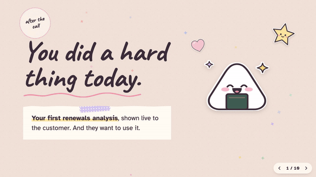

<h1 align="center">rewind-that-call 🌱</h1>
<p align="center"><em>A retro after a call: what happened in the meeting, how the deck was made, and what you and your AI do differently next time.</em></p>

<table>
<tr>
<td width="33%" align="center" valign="top"><a href="https://wan-huiyan.github.io/rewind-that-call/docs/demo/garden.html"></a><br/><sub><b>🌷 Garden</b>: flowers sprout as you go<br/><a href="https://wan-huiyan.github.io/rewind-that-call/docs/demo/garden.html">open live →</a></sub></td>
<td width="33%" align="center" valign="top"><a href="https://wan-huiyan.github.io/rewind-that-call/docs/demo/scrapbook.html"></a><br/><sub><b>📎 Scrapbook</b>: polaroids pin in place<br/><a href="https://wan-huiyan.github.io/rewind-that-call/docs/demo/scrapbook.html">open live →</a></sub></td>
<td width="33%" align="center" valign="top"><a href="https://wan-huiyan.github.io/rewind-that-call/docs/demo/cozy-quest.html"></a><br/><sub><b>🎮 Cozy quest</b>: each tip fills an XP bar<br/><a href="https://wan-huiyan.github.io/rewind-that-call/docs/demo/cozy-quest.html">open live →</a></sub></td>
</tr>
</table>

<p align="center"><sub>The decks show a made-up call (Sam, Morgan, Jo and Kit are invented). Yours is built from your own transcript.</sub></p>

<p align="center">
  <a href="LICENSE"></a>
  <a href="https://github.com/wan-huiyan/rewind-that-call/commits"></a>
  
  <a href="https://claude.com/claude-code"></a>
</p>

> **After a call, your AI agent runs a retro with you: what happened in the meeting, how the deck was made in the run-up, and what you and your AI each do differently next time. It works from the transcript (or the meeting's Gemini notes in your Google Drive), your slides and, if you opt in, the AI's own session log. The debrief itself stays under 600 words.**

<p align="center">
  
</p>
<p align="center"><sub>Based on a real call, details changed.</sub></p>

## Quick start 🚀

Give your AI agent (Claude Code, Codex, Cursor, …) this link and ask it to install the skill:

```text
Install the skill from https://github.com/wan-huiyan/rewind-that-call
```

Most agents can do this. Only the Claude Code route below has been checked; the Codex path is untested.

<details><summary>Prefer to do it by hand?</summary>

```bash
# Claude Code
/plugin marketplace add wan-huiyan/rewind-that-call
/plugin install rewind-that-call@wan-huiyan-rewind-that-call

# Codex (any other agent: point it at SKILL.md in this folder)
git clone https://github.com/wan-huiyan/rewind-that-call /tmp/rewind-that-call
cp -r /tmp/rewind-that-call/plugins/rewind-that-call/skills/rewind-that-call ~/.codex/skills/
```
</details>

## Try it in 60 seconds ⏱️

No call of your own to hand? The repo ships the made-up call behind the demos: a transcript with the garbled numbers in it, the slides and the "I think that went badly" message. After installing, open your agent (Claude Code, Codex, …) inside a clone of this repo and paste:

```text
The call just happened and I think it went badly. How can I do better next time?
@docs/sample/transcript.md @docs/sample/slides.md @docs/sample/message.txt
```

Watch for the three parts: the "pause" at 00:33:00 read as a product launch, not a no; the question at 9:30 whose options only came at 24:00; and the changes for next time. Along the way, "seventy" against the slide's 17 is treated as a transcription error, not your slip.

## Why it exists 💭

After a call you usually get a pep talk or a wall of generic tips ("know your audience"). A retro needs evidence: what the transcript says happened, how the deck got built, and what to change next time. This skill was written after a real client call that felt like it had gone badly, while the transcript said otherwise.

## What the retro looks at 🔎

Three things, from the same made-up call:

**🎤 The meeting.** What actually happened, from the transcript. Where it stands: the "pause" at the end is about their product launch, not a no. What went well, in the audience's own words: Morgan said *"This is going straight into our plan for next quarter."* And the moment it stumbled: *"Morgan asked 'So which one first?' at 9:30. The options came at 24:00."*

**🛠️ How the deck was made.** If an AI built the deck and you opt in, the retro reads that session's log (edit and build counts, times and your own short messages, never tool output): how many changes landed on the day of the call or in the last hour, features added late, what you had to correct twice. Much of what to change sits here, not in the room.

**🌱 Next time, for both of you.** Changes for you (for example, lead with the answer) and, if you opt in, up to 5 rules for your AI (for example, treat the deadline as a freeze), each tied to a timestamp or log time where one exists. The AI rules are saved only if you say yes.

It is careful with the evidence too: a figure that sounds like the slide's ("seventy" for 17) is treated as a speech-to-text error, not your slip. Where a figure is only partly garbled or unrelated to the slide, it asks you what you said before blaming anyone.

## What you get ✨

| | Part | What you get |
|---|---|---|
| 🧭 | **Where it stands** | 3 to 5 bullets: what the audience decided, quoted with timestamps, and what a "pause" or "no" literally covers |
| 🌸 | **What went well** | 2 or 3 points quoting the audience's own words. If nobody said anything positive, something they did; if nothing at all, it says so. Never invented |
| 🎙️ | **Spoken figures vs slides** | A figure that sounds like the slide's (17 vs "seventy") is called a transcription error, not a slip |
| 🎤 | **Presenting** | At most 5 changes, each tied to a moment ("they asked which one first at 9:30; the options came at 24:00") |
| 🛠️ | **How the deck was made** | At most 4 changes to how the deck got built, split by who owns them (you, a teammate or your AI) |
| ⏰ | **Time** | 0 to 2 changes, only when the evidence shows how prep went (for example, the deck was still changing in the last hour) |
| 👣 | **One next action** | Something doable today, usually prep for the meeting already booked |
| 🧠 | **Lessons for your AI** | Optional, if an AI built the deck: it reads that session's log (counts, times and your own short messages; Claude Code tested, Codex and Cursor untested) and writes up to 5 rules for itself, each with the evidence, saved only if you say yes |
| 🍜 | **Cheer-up page** | Offered in one line: a cute HTML page or slide deck of the learnings, in [garden 🌷](https://wan-huiyan.github.io/rewind-that-call/docs/demo/garden.html), [scrapbook 📎](https://wan-huiyan.github.io/rewind-that-call/docs/demo/scrapbook.html) or [cozy quest 🎮](https://wan-huiyan.github.io/rewind-that-call/docs/demo/cozy-quest.html) style |

## Usage 💬

> **You:** the call just happened and I think it went badly. Here's the transcript, my slides and my Slack to my manager. How can I do better next time?

> **Your agent** *(illustrative example, a made-up call; the wording is the agent's own each time)*:
> **Where it stands**: The "pause" at 00:33:00 is about their product launch: "any new analysis has to wait until after the launch". That is their own schedule, not a rejection.
> **Spoken figures vs the slides**: "Seventy" against the slide's 17 looks like a transcription error, so I would not coach you on it. "Fifty fifty-five" where the slide says 15 is probably transcription too: did you say 15? If the AI meeting summary repeats either figure, use the slide figures in the follow-up email.
> **Presenting**: 1. Start with the answer. At 00:09:30 Morgan asked "So which one first?", and the options came at 00:24:00.
> **How the deck was made** *(if you opt in to the session log)*: most changes landed on the day of the call, and one instruction had to be given twice. **Next time, for your AI**: treat the deadline as a freeze, and check every instruction is done before the call.

Then ask for the cheer-up page ("can you make our learnings into something cute?") and it follows [`cheer-page-recipe.md`](plugins/rewind-that-call/skills/rewind-that-call/cheer-page-recipe.md): one content file, the three styles in the gallery at the top to pick from, then (if it has a browser tool) a look at every screen before you see it.

## Pairs well with 🎀

- [sparkle-that-page](https://github.com/wan-huiyan/cutify-this): confetti, floating petals and other cute effects for the cheer-up page.
- [huashu-design](https://github.com/alchaincyf/huashu-design): three design directions before anything is built.

Both are optional. Plain HTML and CSS work too.

## Your transcript 🔒

A transcript is usually a client's words, so the skill is careful with it:

- It works from the files you hand it or, if you have connected Google Drive or Calendar, the meeting's own Gemini notes, which it names so you can check it picked the right call. If it has neither, it asks first: help you connect Drive or Calendar, have you send the transcript, or go ahead without one. (Your agent talks to its own provider as usual; the skill adds no service of its own.)
- It never saves client quotes or figures. If you say yes, it saves the pattern ("this client asks for the decision first").
- The cheer-up page uses first names only by default and stays on your machine. It asks before anything is hosted or emailed.
- Reading your AI's own session logs is opt-in. The bundled script prints counts, edit and build times, the session id and your own messages cut to 160 characters, never tool output.

## Limitations 🫶

- Tested on made-up calls: 9 runs on the first version, four rule-breaking inputs on later versions, one first-run check; plus the Drive lookup and the Claude Code log reader on real sessions. Not yet tried across many real calls or other languages.
- It works best from a raw transcript. From an AI meeting summary or your own notes it still gives the structure, but no timestamps, and it says so.
- It cannot hear the audio, so it cannot be sure about a misheard figure. It decides from the transcript and the audience's reaction, and asks you when the figure is only partly garbled or unrelated to the slide.
- "Lessons for your AI" needs a bash shell and `jq` (plus `sqlite3` for Cursor), and the build session on this machine within the last 7 days. The Claude Code reader is tested; the Codex and Cursor readers are written from their storage formats and not yet tried on a real session.
- Finding the notes through Drive is tested on one real call; through Calendar attachments it is not yet tested.
- It is not presentation-skills training. It works from one call's evidence, not general advice.
- The three demo decks are fiction: a made-up call with invented people, written to show the styles. They are not output from a real debrief.

## License


MIT © Huiyan Wan
