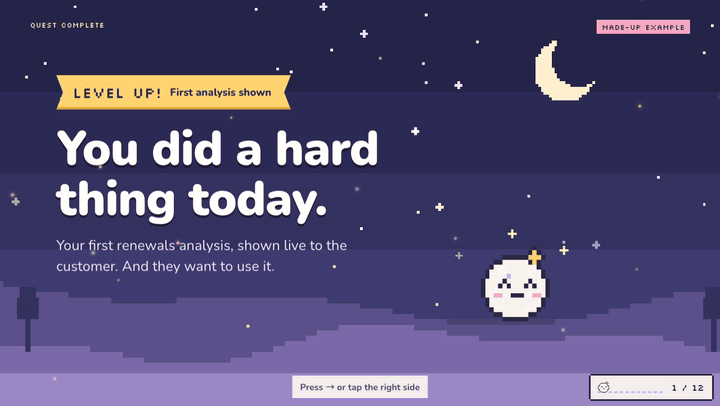

<h1 align="center">rewind-that-call 🌱</h1>
<p align="center"><em>The kind, specific debrief you need right after a presentation that felt like it went badly.</em></p>

<table>
<tr>
<td width="33%" align="center" valign="top"><a href="https://wan-huiyan.github.io/rewind-that-call/docs/demo/garden.html"></a><br/><sub><b>🌷 Garden</b>: flowers sprout as you go<br/><a href="https://wan-huiyan.github.io/rewind-that-call/docs/demo/garden.html">open live →</a></sub></td>
<td width="33%" align="center" valign="top"><a href="https://wan-huiyan.github.io/rewind-that-call/docs/demo/scrapbook.html"></a><br/><sub><b>📎 Scrapbook</b>: polaroids pin in place<br/><a href="https://wan-huiyan.github.io/rewind-that-call/docs/demo/scrapbook.html">open live →</a></sub></td>
<td width="33%" align="center" valign="top"><a href="https://wan-huiyan.github.io/rewind-that-call/docs/demo/cozy-quest.html"></a><br/><sub><b>🎮 Cozy quest</b>: each tip fills an XP bar<br/><a href="https://wan-huiyan.github.io/rewind-that-call/docs/demo/cozy-quest.html">open live →</a></sub></td>
</tr>
</table>

<p align="center"><sub>The decks show a made-up call (Morgan, Jo and Kit are invented). Yours is built from your own transcript.</sub></p>

<p align="center">
  <a href="LICENSE"></a>
  <a href="https://github.com/wan-huiyan/rewind-that-call/commits"></a>
  
  <a href="https://claude.com/claude-code"></a>
</p>

> **Hand your AI agent the call transcript (or let it find the meeting's Gemini notes in your Google Drive), your slides and your "I think that went badly" message, and get back a debrief under 600 words: what the audience actually decided, what went well in their own words, and at most a handful of changes, each tied to the minute it would have helped.**

<p align="center">
  
</p>
<p align="center"><sub>A retro after the call: what happened in the meeting, how the deck was made, and what you and your AI do differently next time. Based on a real call, details changed.</sub></p>

## Quick start 🚀

Give your AI agent (Claude Code, Codex, Cursor, …) this link and ask it to install the skill:

```text
Install the skill from https://github.com/wan-huiyan/rewind-that-call
```

It works out where skills go for that agent.

<details><summary>Prefer to do it by hand?</summary>

```bash
# Claude Code
/plugin marketplace add wan-huiyan/rewind-that-call
/plugin install rewind-that-call@wan-huiyan-rewind-that-call

# Codex (any other agent: point it at SKILL.md in this folder)
git clone https://github.com/wan-huiyan/rewind-that-call /tmp/rewind-that-call
cp -r /tmp/rewind-that-call/plugins/rewind-that-call/skills/rewind-that-call ~/.codex/skills/
```
</details>

## Try it in 60 seconds ⏱️

No call of your own to hand? The repo ships the made-up call behind the demos: a transcript with the garbled numbers in it, the slides and the "I think that went badly" message. After installing, open your agent (Claude Code, Codex, …) inside a clone of this repo and paste:

```text
The call just happened and I think it went badly. How can I do better next time?
@docs/sample/transcript.md @docs/sample/slides.md @docs/sample/message.txt
```

Watch for "seventy" against the slide's 17 being called a transcription error, and the "pause" at 00:33:00 read as a product launch, not a no.

## Why it exists 💭

After a hard call you usually get one of two things: a pep talk, or a wall of generic tips ("know your audience"). Neither helps. This skill was written after a real client call that felt like it had flopped, while the transcript said otherwise.

## What it catches 🔎

Three things a tired presenter misses the evening after, all from the same made-up call:

**🚦 The "no" that wasn't one.** The call ended on a "pause", and you heard a rejection. The transcript says the pause is about a product launch this month, and the same Morgan said *"This is going straight into our plan for next quarter."*

**🎙️ The slip you never made.** The notetaker wrote "seventy" where your slide says 17. An AI reading that transcript can easily coach you to "say the numbers as on the slide". This skill checks the spoken figure against the slide first, calls it a transcription error, and asks before it blames you.

**🌸 The win you didn't notice.** Easy to miss while you are presenting: Morgan put your main finding in her own words (*"So it's really about getting a second person in?"*) and asked to show it to her boss on Monday. That goes first, before any advice.

And every change it suggests points at a minute of the call: *"Morgan asked 'So which one first?' at 9:30. The options came at 24:00. Next time, lead with the answer."*

## What it does ✨

| | Part | What you get |
|---|---|---|
| 🧭 | **Where it stands** | 3 to 5 bullets: what the audience decided, quoted with timestamps, and what a "pause" or "no" literally covers |
| 🌸 | **What went well** | 2 or 3 points in the audience's own words. Always there, even when it went badly |
| 🎙️ | **Spoken figures vs slides** | A figure that sounds like the slide's (17 vs "seventy") is called a transcription error, not a slip |
| 🎤 | **Presenting** | At most 5 changes, each tied to a moment ("they asked which one first at 9:30; the options came at 24:00") |
| 🛠️ | **Workflow** | At most 4 changes, split by who owns them, an AI deck-builder included |
| ⏰ | **Time** | 1 or 2 changes, only when the chat shows it (for example, the deck was still changing in the last hour) |
| 👣 | **One next action** | Something doable today, usually prep for the meeting already booked |
| 🧠 | **Lessons for your AI** | Optional, if an AI built the deck: it reads that session's log (counts and times only; Claude Code tested, Codex and Cursor untested) and writes up to 5 rules for itself, each with the evidence, saved only if you say yes |
| 🍜 | **Cheer-up page** | Offered in one line: a cute HTML page or slide deck of the learnings, in [garden 🌷](https://wan-huiyan.github.io/rewind-that-call/docs/demo/garden.html), [scrapbook 📎](https://wan-huiyan.github.io/rewind-that-call/docs/demo/scrapbook.html) or [cozy quest 🎮](https://wan-huiyan.github.io/rewind-that-call/docs/demo/cozy-quest.html) style |

## Usage 💬

> **You:** the call just happened and I think it went badly. Here's the transcript, my slides and my Slack to my PM. How can I do better next time?

> **Your agent** *(illustrative example, a made-up call; the wording is the agent's own each time)*:
> **Where it stands**: The "pause" at 00:33:00 is "a product launch this month, so new analysis waits until after it". That is about their own schedule, not a rejection.
> **Spoken figures vs the slides**: "Seventy" against the slide's 17 looks like a transcription error, so I would not coach you on it. "Fifty fifty-five" where the slide says 15 is probably transcription too: did you say 15? If the AI meeting summary repeats either figure, use the slide figures in the follow-up email.
> **Presenting**: 1. Start with the answer. At 00:09:30 Morgan asked "So which one first?", and the options came at 00:24:00.

Then ask for the cheer-up page ("can you make our learnings into something cute?") and it follows [`cheer-page-recipe.md`](plugins/rewind-that-call/skills/rewind-that-call/cheer-page-recipe.md): one content file, the three styles in the gallery at the top to pick from, then a check of every screen before you see it.

## Pairs well with 🎀

- [sparkle-that-page](https://github.com/wan-huiyan/cutify-this): confetti, floating petals and other cute effects for the cheer-up page.
- [huashu-design](https://github.com/alchaincyf/huashu-design): three design directions before anything is built.

Both are optional. Plain HTML and CSS work too.

## Your transcript 🔒

A transcript is usually a client's words, so the skill is careful with it:

- It works from the files you hand it or, if you have connected Google Drive or Calendar, the meeting's own Gemini notes, which it names so you can check it picked the right call. If it has neither, it asks first: help you connect Drive or Calendar, have you send the transcript, or go ahead without one. (Your Claude Code session talks to Anthropic as usual; the skill adds no other service.)
- It never saves client quotes or figures to memory. If you say yes, it saves the pattern ("this client asks for the decision first"), dated.
- The cheer-up page uses first names only and stays on your machine. It asks before anything is hosted or emailed.
- Reading your AI's own session logs is opt-in, and the bundled script prints only counts, edit times and your own short messages, never tool output.

## Limitations 🫶

- Tested on one made-up call, 9 runs in all. It has not yet been tried across many real calls or other languages.
- It works best from a raw transcript. From an AI meeting summary or your own notes it still gives the structure, but no timestamps, and it says so.
- It cannot hear the audio, so it cannot tell a real slip from a transcription error. It asks you instead.
- "Lessons for your AI" needs the build session on this machine from the last 7 days, and `jq`. The Claude Code reader is tested; the Codex and Cursor readers are written from their storage formats and not yet tried on a real session.
- Finding the notes through Drive is tested on one real call; through Calendar attachments it is not yet tested.
- It is not presentation-skills training. It works from one call's evidence, not general advice.
- The three demo decks are fiction: a made-up call with invented people, written to show the styles. They are not output from a real debrief.

## License


MIT © Huiyan Wan
